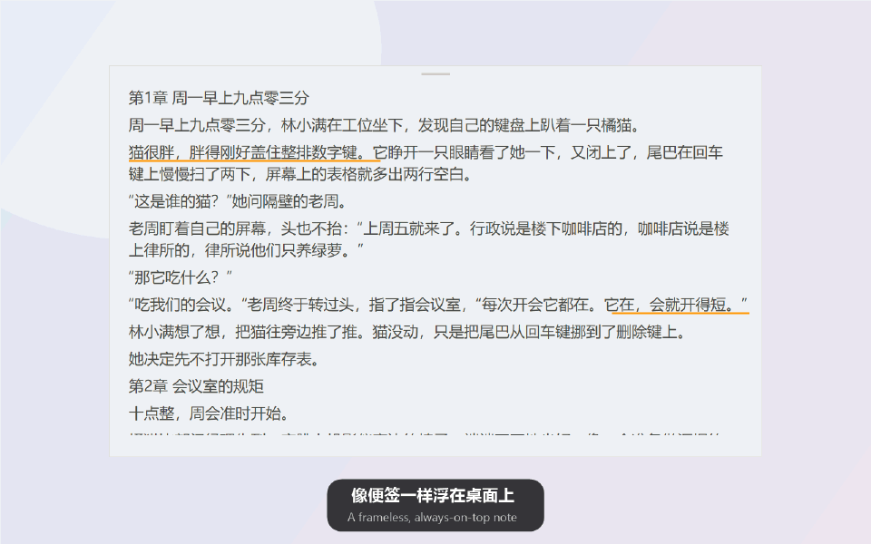

<div align="center">

# Inkognito

**A stealth desktop novel reader for Windows. Boss walks by? One key and it's gone.**

A ~100 KB, frameless, always-on-top reader that can pass as an Excel sheet or a code editor,<br>
and stays invisible in screenshots and screen sharing.

[](https://github.com/Cleoooyan/Inkognito/releases/latest)


[简体中文](README.md) · English



</div>

> The interface is in Simplified Chinese. It reads any TXT (GBK, UTF-8, UTF-16, Big5…) or EPUB file.

## Features

- **Boss key** – hold `` ` `` and press `1` to hide or show the window from any app. A lone `` ` `` still types normally. Win+`, Tab+Q and Ctrl+Alt combos are also available.
- **Disguises** – switch to an **Excel spreadsheet** (formula bar, column letters, row numbers) or a **VS Code-style editor** (dark or light, with line numbers, tabs and a status bar).
- **See-through mode** – only the text floats over other windows; the background comes back when the mouse is over it.
- **One-line mode** – shrink the reader to a single ticker line.
- **Hidden from capture** – screenshots, recordings and meeting screen shares skip the window (`WDA_EXCLUDEFROMCAPTURE`, Windows 10 2004+). One click turns it off when you want a screenshot yourself.
- **Hide text when the mouse leaves** the window.
- **Highlights and copy** – drag to select, underline or copy; browse every book's highlights and jump back to them.
- **Table of contents and full-text search** – detects “第N章”, “N、title” and EPUB nav/NCX chapters.
- **Follows serials** – open a newer download of the same book and it resumes where you left off, highlights included.
- Smooth touchpad scrolling, auto-scroll with 10 speeds, back/forward after jumps, recent books, five color themes including dark, per-book progress.
- **Tiny and private** – one ~100 KB exe, no installer, no network access, nothing uploaded.

## Get started

1. Download `Inkognito-*.zip` from [Releases](https://github.com/Cleoooyan/Inkognito/releases/latest) and unzip it.
2. Run `Inkognito.exe` (SmartScreen may warn about an unknown publisher: *More info → Run anyway*; the exe is not code-signed).
3. Drag a TXT or EPUB file onto the window. Right-click for everything else.

Requires Windows 10 or 11 (uses the built-in .NET Framework 4.x).

## Build from source

No Visual Studio or SDK needed; the scripts use the C# compiler that ships with Windows:

```powershell
cd source
powershell -ExecutionPolicy Bypass -File build.ps1     # builds ..\Inkognito.exe
powershell -ExecutionPolicy Bypass -File test.ps1      # unit tests
powershell -ExecutionPolicy Bypass -File ui-test.ps1   # window integration tests
```

Reading progress and highlights are stored in `%LOCALAPPDATA%\QuietReader\state.xml`.

## Contributing

Issues and pull requests are welcome: new disguises, more formats, bug reports.
If Inkognito got you through a novel unnoticed, a ⭐ helps others find it.

## License

[MIT](LICENSE)
