<div align="center">

# Inkognito · 便笺阅读器

**上班看小说的桌面阅读器。老板路过，按一下就不见了。**

一个只有 100 多 KB 的 Windows 小工具：无边框、置顶、半透明，<br>
能伪装成 Excel 表格或代码编辑器，开会共享屏幕也拍不到它。

[](https://github.com/Cleoooyan/Inkognito/releases/latest)


简体中文 · [English](README.en.md)

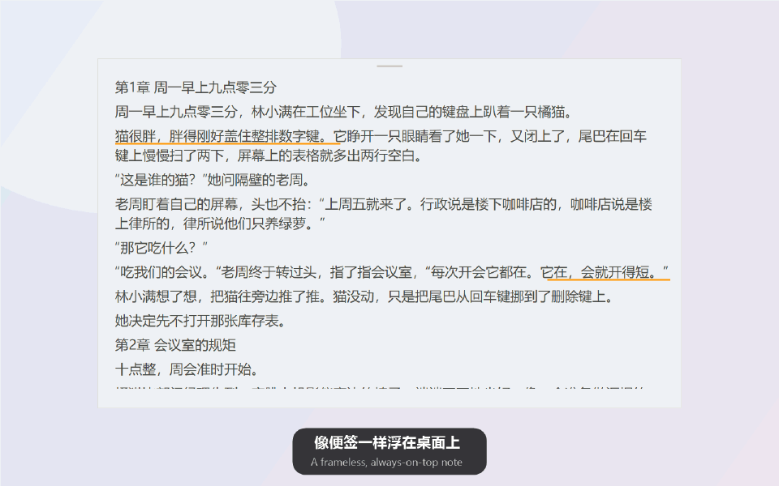

</div>

## 为什么用它

| | |
|---|---|
| ⌨️ **一键隐藏** | 按住 `` ` ``（Esc 下面那个键）再按 `1`，在任何软件里都能瞬间隐藏 / 恢复。单独按 `` ` `` 照常打字，不影响 Excel、WPS。 |
| 🎭 **伪装成工作** | 一键切换成 **Excel 表格**、**深色 / 白色代码编辑器**：行号、列标、公式栏、状态栏一样不少，路过的人只会觉得你在加班。 |
| 👻 **透明模式** | 背景全透明，只剩文字浮在其他窗口上；鼠标移上来才显示背景，方便拖动。 |
| 📏 **单行模式** | 窗口缩成一行字幕，贴在屏幕边上慢慢看。 |
| 🙈 **防截屏** | 截图、录屏、开会共享屏幕都拍不到阅读器（Windows 10 2004 及以上）。自己要截图时右键一键关掉。 |
| 🖱️ **鼠标移开隐藏文字** | 鼠标一离开窗口，文字就消失，只剩一块空白便签。 |
| 🖍️ **划线和复制** | 拖选文字就能划线 / 复制；「我的划线」按书汇总，单击跳回原文，一键复制全部。 |
| 📚 **目录和全文搜索** | 自动识别「第 N 章」「N、标题」等章节格式；输章号直接跳，搜人名、关键词。 |
| 🔁 **连载追更不丢进度** | 下载了同一本书的新版本（文件名带日期也没关系），打开就接着上次的位置读，划线一起带过来。 |
| 🪶 **小而干净** | 一个 100 多 KB 的 exe，不用安装、不联网、不上传任何东西。支持 TXT（自动识别 GBK / UTF-8 / UTF-16 等编码）和 EPUB。 |

还有：触控板顺滑滚动、自动滚动（10 档速度）、跳转后一键返回、最近阅读、5 种配色含深色、自定义字体和透明度、每本书单独记进度。

## 下载和使用

1. 到 [Releases](https://github.com/Cleoooyan/Inkognito/releases/latest) 下载 `Inkognito-*.zip`，**解压**到任意文件夹。
2. 双击 `Inkognito.exe`。
3. 把 TXT 或 EPUB 小说拖进窗口，开始摸鱼。

> 第一次运行时 Windows 可能提示「已保护你的电脑」：点「更多信息」→「仍要运行」。
> 这是因为程序没有购买代码签名证书。源码都在这里，可以自己编译（见下文）。

需要 Windows 10 或 11（系统自带 .NET Framework 4.x，不用另装任何东西）。

## 截图

<table>
<tr>
<td width="50%">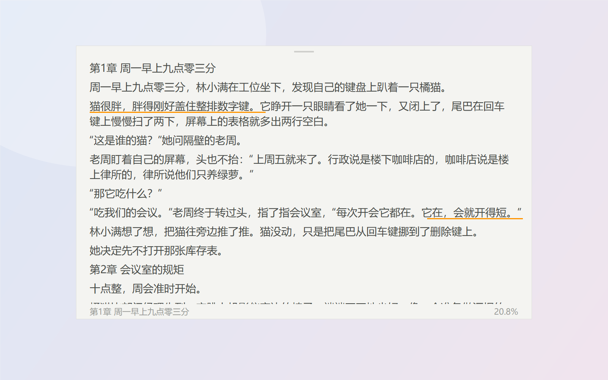<br><sub><b>便笺</b>：默认样式，悬停显示章节和进度</sub></td>
<td width="50%">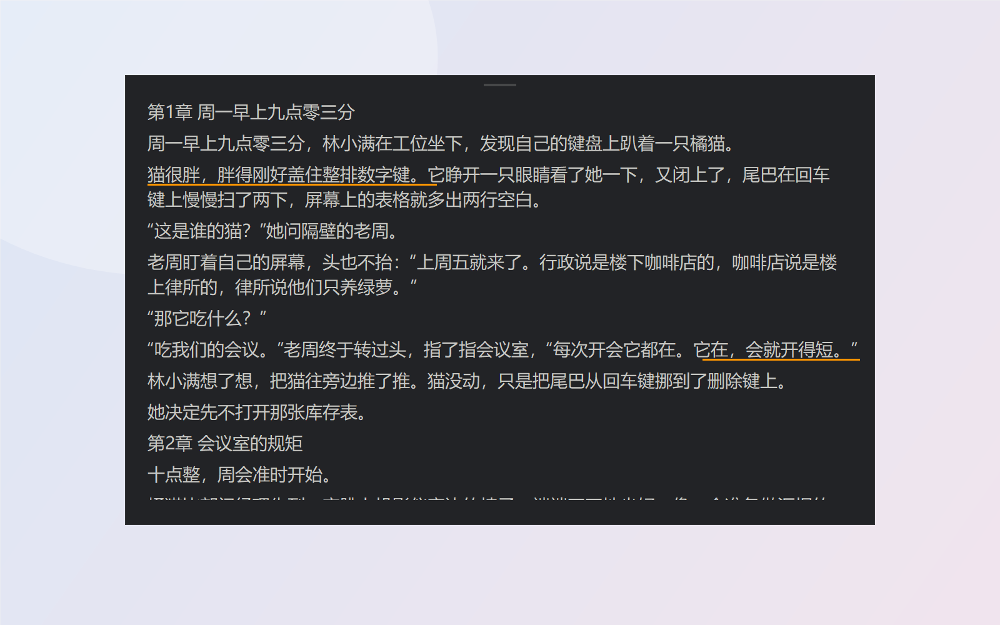<br><sub><b>深色</b>：5 种配色，也能自定义</sub></td>
</tr>
<tr>
<td>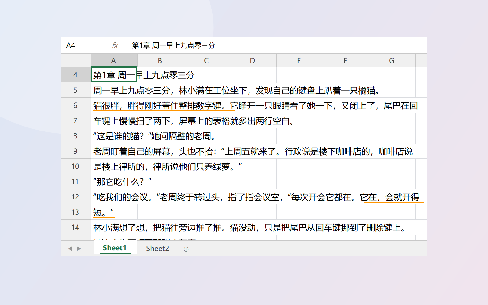<br><sub><b>Excel 表格</b>：行号就是段落号</sub></td>
<td>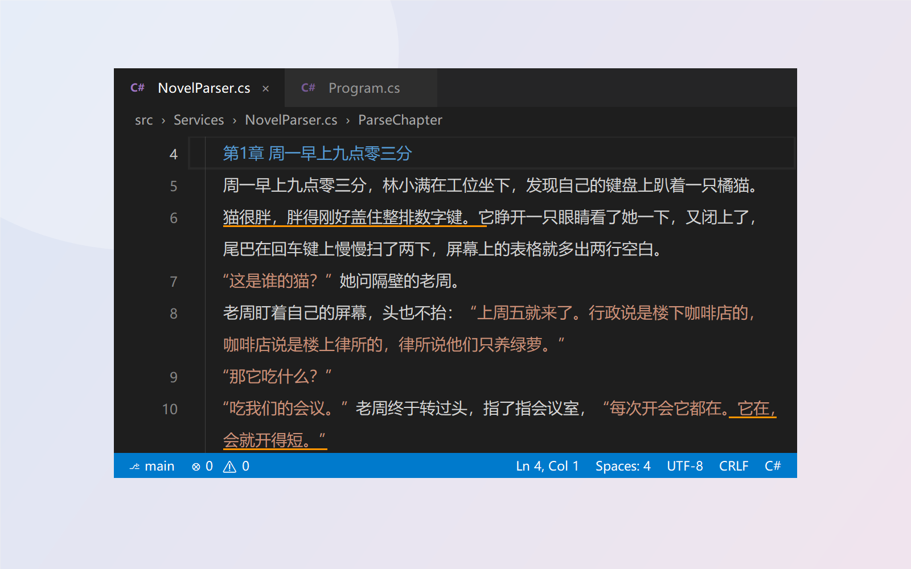<br><sub><b>代码编辑器</b>：对话按字符串着色，章节名按关键字着色</sub></td>
</tr>
<tr>
<td>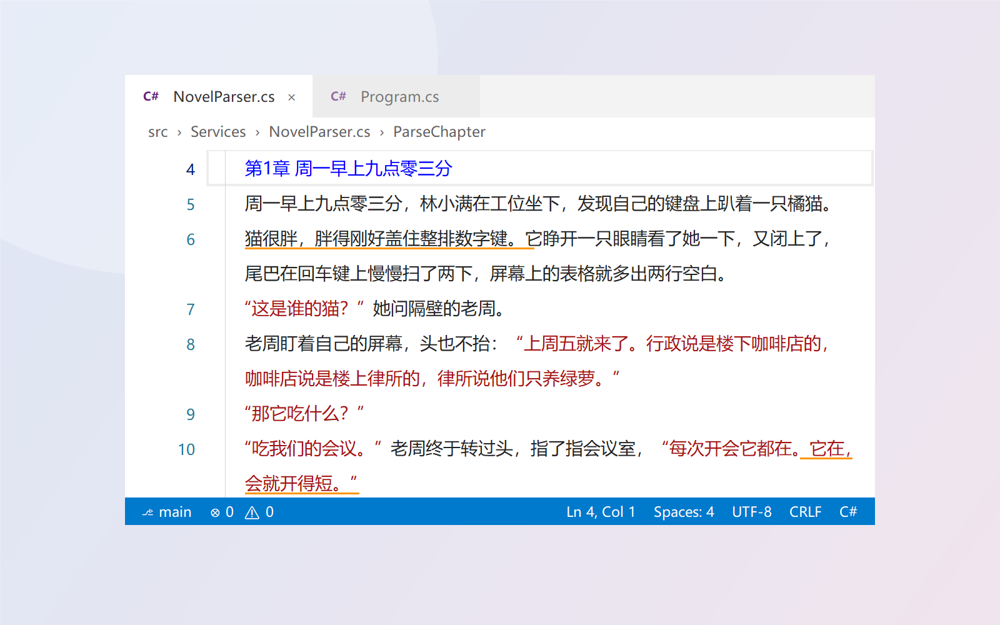<br><sub><b>白色代码编辑器</b></sub></td>
<td>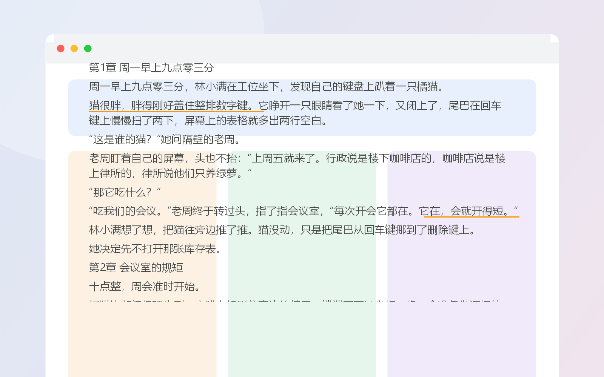<br><sub><b>透明</b>：只剩文字浮在别的窗口上</sub></td>
</tr>
<tr>
<td>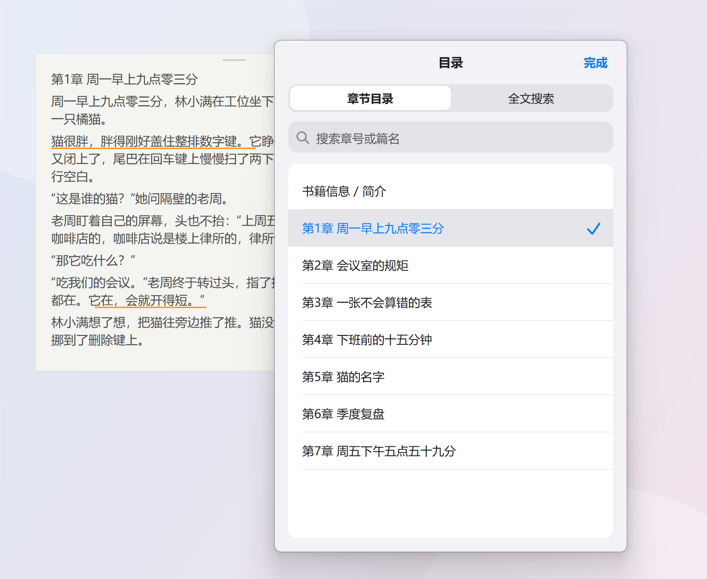<br><sub><b>目录 / 全文搜索</b></sub></td>
<td>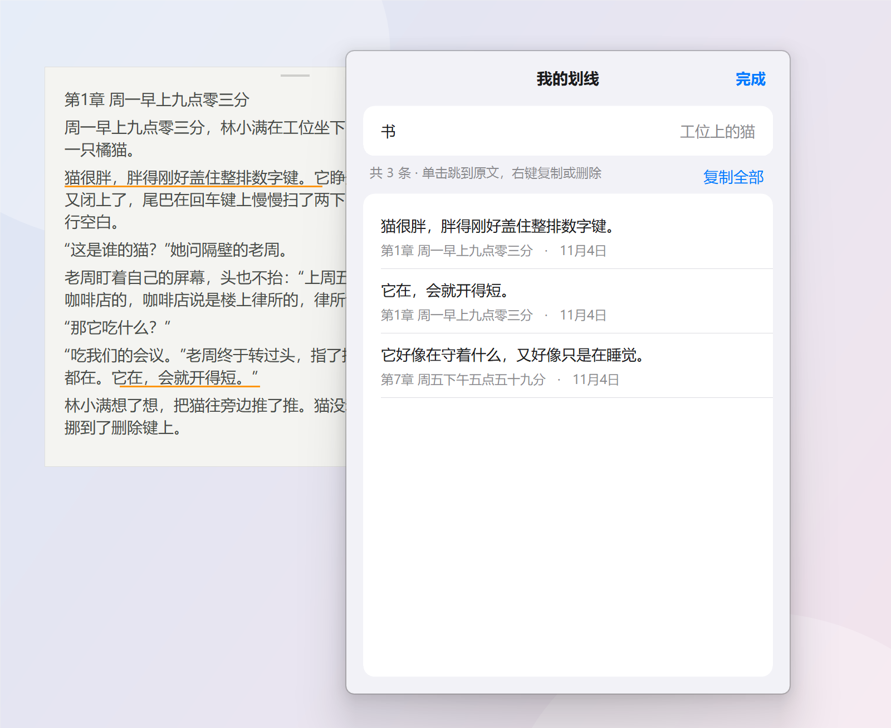<br><sub><b>我的划线</b>：按书查看，单击跳回原文</sub></td>
</tr>
<tr>
<td>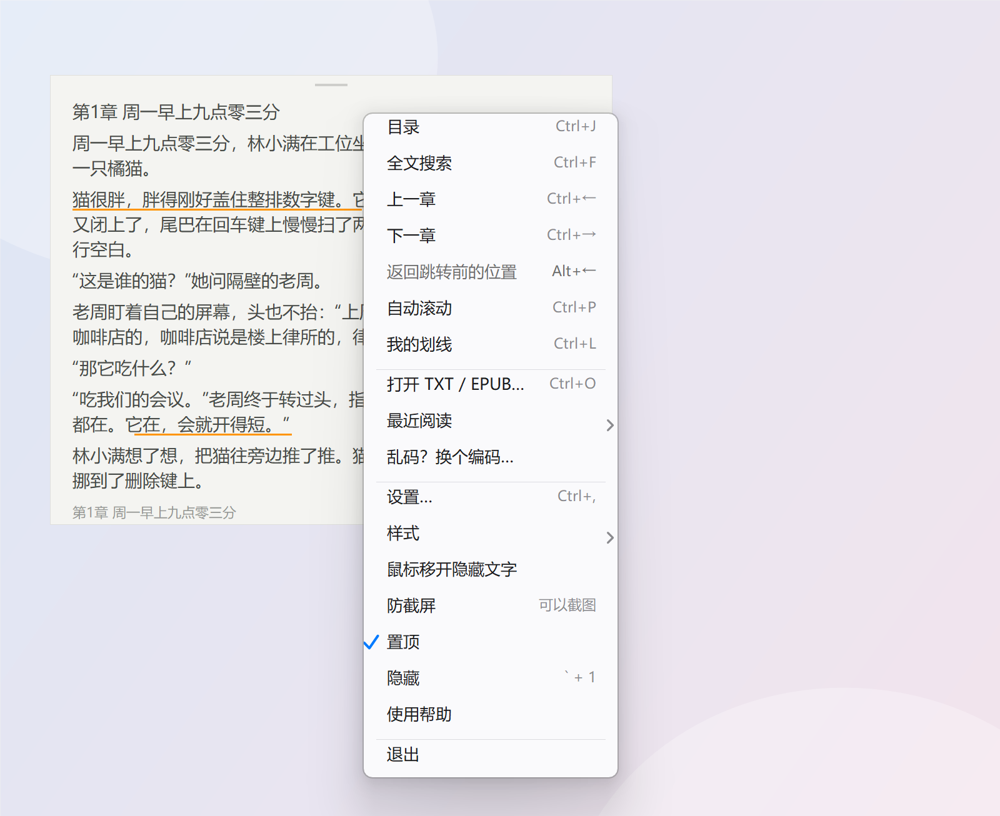<br><sub>所有功能都在<b>右键菜单</b>里</sub></td>
<td>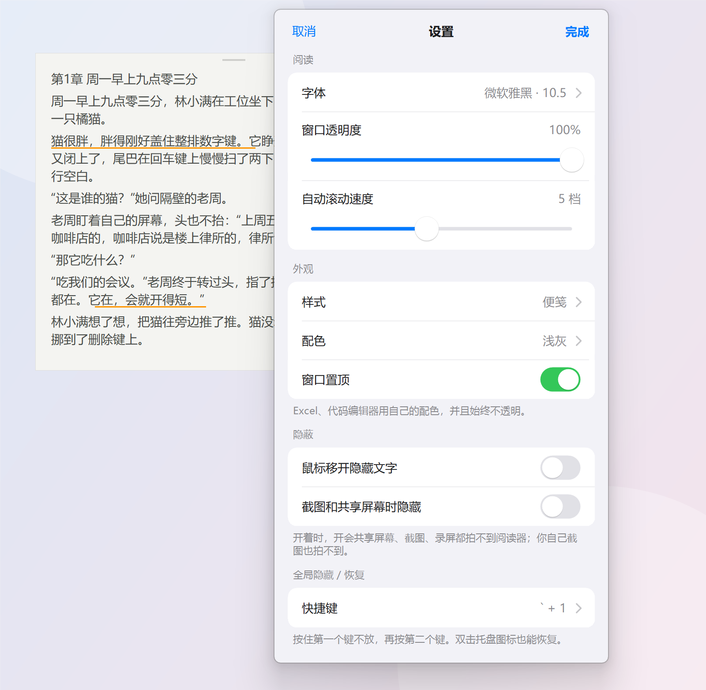<br><sub><b>设置</b>：字体、透明度、配色、快捷键</sub></td>
</tr>
</table>

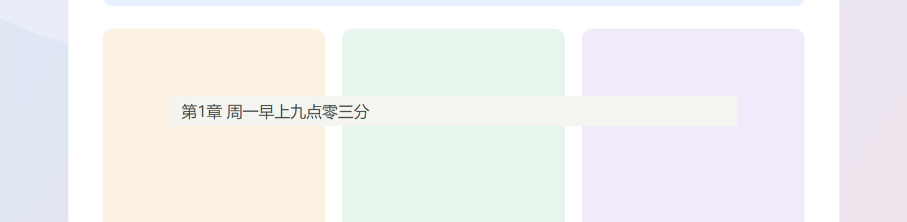<br><sub><b>单行模式</b>：缩成一行，贴在任何地方</sub>

## 快捷键

| 按键 | 作用 |
|---|---|
| `` ` `` + `1` | 隐藏 / 恢复（全局，任何软件里都能用；可在设置里换成 Win+`、Tab+Q 等） |
| `Esc` | 立刻隐藏 |
| 滚轮 / 触控板、`PageDown` / `空格`、`PageUp` | 滚动、翻页 |
| `Ctrl+J` / `Ctrl+F` | 目录 / 全文搜索 |
| `Ctrl+←` / `Ctrl+→` | 上一章 / 下一章 |
| `Alt+←` / `Alt+→` | 跳转后返回原来的位置 / 再前进 |
| `Ctrl+P`，`Ctrl+↑` / `Ctrl+↓` | 自动滚动开关，调速度 |
| `Ctrl+L` | 我的划线 |
| `Ctrl+C` | 复制选中的文字 |
| `Ctrl+O` / `Ctrl+,` | 打开书 / 设置 |
| `Alt` + 拖动正文 | 移动窗口 |

找不到窗口了？双击托盘里的程序图标（可能收在任务栏的「^」里）。

## 常见问题

**进度和划线存在哪？**
存在本机 `%LOCALAPPDATA%\QuietReader\state.xml`，每本书按文件内容单独记。换文件名、换文件夹都认得出来。

**防截屏是怎么做到的？会不会被发现？**
用的是 Windows 自带的 `SetWindowDisplayAffinity(WDA_EXCLUDEFROMCAPTURE)`，系统在截图和共享屏幕时直接跳过这个窗口，拍出来是它后面的内容。Windows 10 2004 之前的系统会显示成黑块。

**打开 TXT 是乱码？**
右键 →「乱码？换个编码…」，选 GBK / Big5 / UTF-8 等，会按书记住。

**快捷键和别的软件冲突？**
设置 → 快捷键，可以换成 Win+`、Tab+Q 或几个 Ctrl+Alt 组合。被占用时程序会自动换一个能用的并提示你。

**会被杀毒软件报毒吗？**
全局快捷键用到了键盘钩子（只识别那一个组合键，不记录任何输入），个别杀毒软件可能会提示。不放心可以直接从源码编译。

## 从源码编译

不需要安装 Visual Studio 或 .NET SDK，用 Windows 自带的 C# 编译器就行：

```powershell
cd source
powershell -ExecutionPolicy Bypass -File build.ps1     # 生成 ..\Inkognito.exe
powershell -ExecutionPolicy Bypass -File test.ps1      # 单元测试
powershell -ExecutionPolicy Bypass -File ui-test.ps1   # 窗口集成测试
```

代码结构：

| 文件 | 内容 |
|---|---|
| `Core.cs` | 书籍加载、编码识别、章节识别、分页排版、进度和划线存储 |
| `Epub.cs` | EPUB 解析（spine 顺序、nav / NCX 目录） |
| `Skins.cs` | 便笺、透明、单行、Excel、代码编辑器等样式 |
| `ReaderForm.cs` | 主窗口：滚动、翻页、选择、划线、菜单 |
| `Dialogs.cs` / `Ios.cs` | 目录、设置、划线面板和 iOS 风格控件 |
| `Hotkeys.cs` | 全局组合键（低级键盘钩子） |

`samples/工位上的猫.txt` 是为本项目写的原创短篇，测试和截图都用它，可以随便用。

## 参与

欢迎提 Issue 和 PR：新的伪装样式（PPT？邮件？）、更多书籍格式、Bug 反馈都可以。

如果它帮你安全地读完了一本书，点个 ⭐ 让更多打工人看到它吧。

## 许可

[MIT](LICENSE)

## Star History

[](https://star-history.com/#Cleoooyan/Inkognito&Date)
